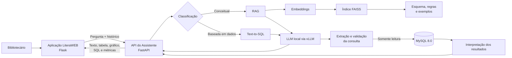

# LiteraWEB — Assistente Local com RAG e Text-to-SQL

> Um ambiente de domínio construído para experimentar como uma LLM local pode compreender regras de negócio, consultar dados relacionais e transformar perguntas em linguagem natural em respostas, tabelas, gráficos e consultas SQL explicáveis.

## Visão geral

O **LiteraWEB** é um projeto desenvolvido em torno de um problema central:

> **Como permitir que uma pessoa consulte regras e dados de um sistema corporativo usando linguagem natural, sem precisar conhecer SQL ou navegar por diversos relatórios?**

Para esse problema, foi construído um sistema de gerenciamento de biblioteca como contexto. O domínio da biblioteca funciona como o **contexto aplicado da solução de Inteligência Artificial**, fornecendo:

- dados relacionais;
- regras de negócio;
- diferentes perfis de acesso;
- estados e históricos de operações;
- consultas analíticas;
- informações que podem ser apresentadas como texto, tabela ou gráfico.

O principal componente técnico do projeto é um **Assistente Inteligente local**, executado separadamente da aplicação web e baseado em:

- **Large Language Model (LLM)**;
- **Retrieval-Augmented Generation (RAG)**;
- **Text-to-SQL**;
- **embeddings semânticos**;
- **FAISS**;
- **vLLM**;
- **FastAPI**;
- **MySQL 8.0**.

A aplicação de biblioteca não é apenas uma interface para cadastro e reservas. Ela representa um domínio no qual a LLM pode ser testada com regras, relacionamentos, perguntas de acompanhamento e consultas sobre dados estruturados.

---

## O foco do projeto

O repositório demonstra um pipeline no qual o bibliotecário pode fazer perguntas como:

```text
Quantos exemplares estão disponíveis atualmente?
```

```text
Quais categorias possuem mais livros reservados?
```

```text
Quais livros têm maior chance de serem reservados no próximo mês?
```

```text
Qual é a política ativa de empréstimo?
```

```text
Usando apenas os dados disponíveis no sistema, estime a demanda por categoria para os próximos 30 dias. Informe quais variáveis históricas foram consideradas, quais limitações reduzem a confiabilidade da previsão e diferencie claramente dados observados de valores estimados.
```

O assistente analisa a intenção da pergunta e decide entre dois fluxos principais:

1. **Pergunta conceitual**  
   A resposta é produzida com base nas regras e na documentação recuperadas pelo RAG.

2. **Pergunta baseada em dados**  
   A LLM gera uma consulta SQL de leitura, o sistema valida essa consulta, executa-a no MySQL e transforma os resultados em uma resposta compreensível.

O usuário pode receber:

- resposta em linguagem natural;
- tabela;
- gráfico;
- consulta SQL gerada;
- tempo de processamento;
- quantidade de tokens;
- documentos recuperados pelo RAG;
- métricas de CPU, RAM, GPU e VRAM do servidor.

---

## Arquitetura

Durante o desenvolvimento, a aplicação web e o módulo de Inteligência Artificial eram executados separadamente.



### Separação dos serviços

```text
Servidor da aplicação
└── Flask, HTML, CSS, JavaScript e MySQL

Servidor de Inteligência Artificial
├── FastAPI
├── RAG
├── SentenceTransformers
├── FAISS
├── vLLM
└── LLM local
```

A comunicação entre os serviços ocorre por HTTP. Portanto, o código do assistente está no mesmo repositório apenas para documentação; ele continua sendo executado em um ambiente próprio.

---

## Pipeline do Assistente Inteligente

### 1. Recebimento da pergunta

A aplicação Flask envia à API:

- pergunta atual;
- histórico recente da conversa;
- contexto necessário para manter perguntas de acompanhamento.

A API limita e normaliza o histórico antes do processamento.

### 2. Reescrita de perguntas de acompanhamento

Perguntas como:

```text
E somente os que estão atrasados?
```

dependem da mensagem anterior. O assistente utiliza o histórico para reconstruir uma pergunta independente e mais clara antes de continuar o pipeline.

### 3. Classificação da intenção

A pergunta é classificada como:

- **conceitual**, quando trata de regras, políticas ou funcionamento do sistema;
- **baseada em dados**, quando exige informações atuais armazenadas no MySQL.

Essa separação evita consultar o banco quando a resposta pode ser obtida diretamente da base de conhecimento.

### 4. Recuperação de contexto com RAG

A base de conhecimento descreve:

- tabelas e colunas;
- relacionamentos;
- regras de negócio;
- significados dos status;
- políticas do sistema;
- exemplos de consultas;
- restrições para geração de SQL.

O arquivo de contexto é dividido em blocos semânticos. O `indexador.py` gera embeddings para esses blocos e constrói um índice FAISS.

Durante uma pergunta, os trechos semanticamente mais relevantes são recuperados e adicionados ao contexto enviado à LLM.

### 5. Geração pela LLM

O modelo utilizado no ambiente original foi o:

```text
Qwen2.5-Coder-14B-Instruct
```

A inferência foi disponibilizada por um servidor **vLLM** compatível com uma API de chat.

### 6. Text-to-SQL

Para perguntas baseadas em dados, a LLM recebe:

- pergunta;
- esquema relevante;
- relacionamentos;
- regras de negócio;
- exemplos;
- restrições de segurança.

A saída é processada para extrair a consulta SQL final.

### 7. Validação da consulta

Antes da execução, a consulta passa por verificações destinadas a restringir o assistente a operações de leitura.

Entre as regras adotadas estão:

- aceitar consultas iniciadas por `SELECT` ou `WITH`;
- impedir instruções de alteração;
- não retornar senhas;
- evitar campos sensíveis;
- limitar a quantidade de resultados;
- impedir múltiplas instruções;
- registrar a consulta gerada para análise.


### 8. Execução e interpretação

Após a validação:

1. a consulta é executada no MySQL;
2. os resultados são carregados em uma estrutura tabular;
3. a LLM recebe uma representação controlada desses dados;
4. o assistente gera uma explicação em linguagem natural;
5. a API devolve os dados necessários para texto, tabela ou gráfico.

---

## Por que um sistema de biblioteca?

O domínio foi escolhido por oferecer um cenário suficientemente completo para testar uma LLM aplicada a sistemas de informação.

A biblioteca contém:

- livros e exemplares;
- usuários e funcionários;
- reservas;
- retirada presencial e entrega domiciliar;
- empréstimos e devoluções;
- prazos e atrasos;
- políticas configuráveis;
- exclusão lógica;
- fórum;
- comentários e reações;
- notificações;
- diferentes estados e transições.

Isso permite avaliar perguntas simples e consultas com:

- filtros;
- ordenação e paginação;
- agrupamentos;
- agregações;
- relacionamentos entre tabelas;
- consultas aninhadas;
- múltiplos critérios simultâneos;
- períodos e comparações temporais;
- rankings;
- cálculos de duração;
- estados derivados;
- dependências e transições entre estados;
- tratamento de valores nulos e exceções;
- validação de permissões;
- interpretação de regras de negócio;
- resolução de ambiguidades em linguagem natural.
---

## Tecnologias

### IA

- Qwen2.5-Coder-14B-Instruct
- vLLM
- RAG
- Text-to-SQL
- SentenceTransformers
- multi-qa-mpnet-base-dot-v1
- FAISS
- PyTorch
- CUDA
- OpenAI-compatible API

### Serviço do assistente

- Python
- FastAPI
- Uvicorn
- Pydantic
- Pandas
- NumPy
- SQLAlchemy
- PyMySQL
- psutil

### Aplicação de domínio

- Python
- Flask
- SQLAlchemy
- MySQL 8.0
- HTML
- CSS
- JavaScript
- Marked
- DOMPurify
- Chart.js

---

## Modelo não incluído

Os pesos da LLM **não estão incluídos neste repositório**.

O repositório disponibiliza:

- API do assistente;
- pipeline RAG;
- Text-to-SQL;
- prompts e regras;
- processo de indexação;
- base de conhecimento;
- integração com o MySQL;
- coleta de métricas;
- integração entre a aplicação e o servidor de IA.

Também não são distribuídos:

- cache de modelos;
- pesos e checkpoints;
- índice vetorial gerado;
- logs de execução;
- credenciais;

---

# Execução do Assistente Intligente

## Requisitos gerais

- Linux recomendado (Algo como Ubuntu Server ou similar);
- Python compatível com as dependências;
- GPU NVIDIA (No projeto foi utilizado uma 5060TI 16GB);
- CUDA e PyTorch compatíveis;
- vLLM;
- modelo de linguagem instalado separadamente;
- MySQL acessível pelo servidor do assistente.

## 1. Criar o ambiente

```bash
cd assist
python3 -m venv .venv
source .venv/bin/activate
```

## 2. Instalar as dependências

```bash
python -m pip install --upgrade pip
pip install -r requirements.txt
```

A instalação de PyTorch, CUDA, FAISS e vLLM pode variar conforme a GPU e o sistema operacional. 

## 3. Configurar o ambiente

```bash
cp .env.example .env
```

Exemplo de variáveis esperadas:

```env
DB_SERVER=localhost
DB_PORT=3306
DB_DATABASE=literaweb
DB_USER=
DB_PASSWORD=

VLLM_BASE_URL=http://127.0.0.1:8000/v1
VLLM_API_KEY=not-required
VLLM_TIMEOUT=300

LLM_NAME=Qwen2.5-Coder-14B-Instruct
EMBED_MODEL=sentence-transformers/multi-qa-mpnet-base-dot-v1

RAG_TOP_K=6
```

## 4. Gerar o índice vetorial

```bash
python indexador.py
```

O processo:

1. lê a base de conhecimento;
2. separa tabelas, regras e exemplos em chunks;
3. gera embeddings;
4. normaliza os vetores;
5. cria um índice FAISS;
6. salva o armazenamento vetorial localmente.


## 5. Iniciar o vLLM

O comando depende do modelo e do hardware. Um exemplo genérico é:

```bash
vllm serve /caminho/para/o/modelo \
  --host 127.0.0.1 \
  --port 8000
```

Parâmetros como tamanho máximo de contexto, paralelismo e quantidade de sequências devem ser ajustados de acordo com a VRAM disponível.

## 6. Iniciar a API RAG

```bash
uvicorn api_rag:app --host 0.0.0.0 --port 8010
```

## 7. Conectar a aplicação Flask

No `.env` da aplicação web:

```env
RAG_API_URL=http://ENDERECO_DO_SERVIDOR_RAG:8010
```

Em um ambiente local:

```env
RAG_API_URL=http://127.0.0.1:8010
```
---

## Limitações

- A LLM exige infraestrutura própria.
- O desempenho depende do modelo, da GPU e da complexidade da pergunta.
- O projeto não foi auditado para implantação em produção.
- A geração de SQL por LLM não deve ser utilizada como única camada de segurança.
- Não há garantia de compatibilidade com qualquer modelo substituto.
- O índice deve ser regenerado quando a base de conhecimento for alterada.

---

